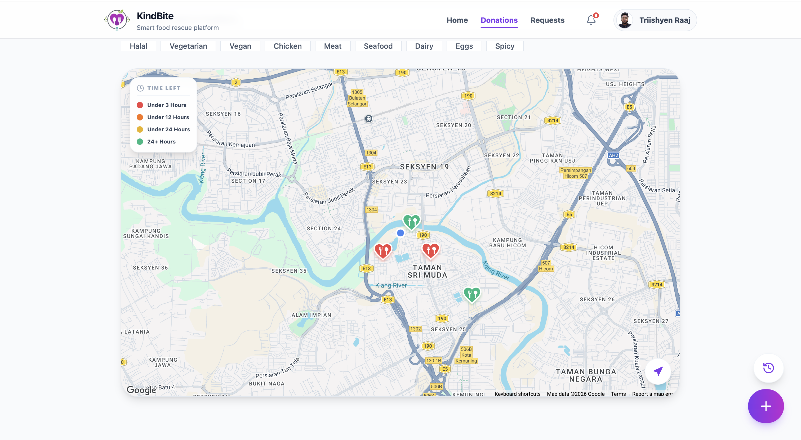

# KindBite | Smart Food Rescue & Donation Management System
**PIXEL 2026 Silver Medalist – Universiti Sains Malaysia**

**🎥 [Watch the System Demo Here](https://drive.google.com/file/d/15boanTFBgwYEbQvR0Jnw1tdwJZ_Myu5t/view?usp=drive_link)** | **📄 [Read the Full Technical Report](docs/CAT404_Final_Report_163643_Triishyen.pdf)**

### Project Overview
KindBite is a serverless, peer-to-peer web application designed to bridge the gap between surplus food generation and food insecurity. Operating on a dual-flow model, the platform empowers donors to list surplus food and recipients to broadcast specific needs without relying on centralized warehousing.

### Tech Stack
* **Frontend:** React.js, Tailwind CSS
* **Backend:** Firebase (Firestore, Cloud Functions, Authentication, Cloud Messaging, Storage)
* **External APIs:** Gemini AI, Google Maps API
* **Testing:** Playwright, Vitest, JSDOM, Postman

### Core Architecture & Engineering Features
* **Serverless Dual-Flow Engine:** Engineered a P2P redistribution platform utilizing atomic database transactions, Role-Based Access Control (RBAC), and real-time WebSocket listeners to eliminate race conditions during concurrent food reservations.
* **AI-Assisted Listing & Guardrails:** Integrated the Gemini AI API to automate image classification and generate semantic food tags. Built strict validation guardrails to automatically reject non-food uploads, route user handoffs without automated food safety verification, and explicitly prevent the auto-assignment of Halal tags to uncertain items.
* **100-Point Smart Matching:** Architected a heuristic matching engine via Cloud Functions that evaluates proximity, urgency, dietary needs, and quantity. The algorithm executes the Haversine formula to power personalized feed ranking, push notifications, and FEFO (First Expire, First Out) logistics.
* **Geospatial Discovery:** Utilized the Google Maps API to render interactive geospatial canvases and custom SVG clustering for localized food discovery.
* **Secure P2P Handovers:** Secured physical handovers using the HTML5 MediaDevices API for cryptographic QR-code verification between donors and recipients.
* **Asynchronous Impact Analytics:** Developed scheduled cron jobs to aggregate environmental metrics, denormalizing payload data for highly efficient O(1) dashboard reads.
* **Comprehensive Testing:** Validated system stability across unit, integration, system, and UAT phases, executing 73 automated tests to achieve a 100% pass rate.

### System Previews

*(Note: Be sure to upload your screenshots to a `docs` folder in your repository and update this image filename to match)*
